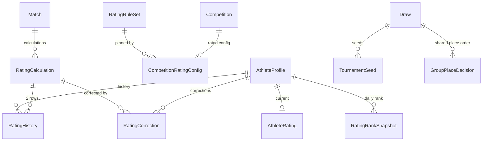

# RATING_ARCHITECTURE — рейтинговая система и рейтинговые турниры

Статус: **реализовано** (фазы 1–16 ТЗ 75, PR #29–#44, 2026-10-18 — 2026-10-20). Документ описывает систему так, как она
сделана; решения заказчика — раздел 15, приёмка — [RATING_ACCEPTANCE.md](RATING_ACCEPTANCE.md).
Правила расчёта — [RATING_RULES.md](RATING_RULES.md); формат турнира — [RATED_TOURNAMENT_FORMAT.md](RATED_TOURNAMENT_FORMAT.md).

## 1. Где рейтинг встаёт в архитектуру

Платформа — модульный монолит NestJS (`apps/api/src/modules/<domain>`: `api → application → domain`), Prisma + PostgreSQL 16, фоновые задачи в `apps/worker` (BullMQ), события — transactional outbox (`OutboxService.enqueue` в транзакции команды, ADR-08), аудит — `AuditService.record` в той же транзакции, права — каталог `packages/contracts/src/permissions.ts` и матрица `roles.ts`, схемы API — Zod в `packages/contracts`.

На что опирается рейтинг:

| Есть | Как используется |
|---|---|
| `Competition` (статусы DRAFT → … → ARCHIVED, `publishedAt`) | Поле `competitionType`; «защищённое состояние» — опубликован или есть рейтинговый расчёт |
| `CompetitionCategory.formatOverride`, `Draw.format` (`CompetitionFormatCode`) | Формат `SPECIAL_GROUP_RATED` |
| `AthleteProfile` (+ `Person`) | `AthleteRating` 1:1 по `athleteId` |
| `Entry` → `MatchParticipant` (сторона RED/BLUE) | Спортсмены схватки: `entry.athleteId` |
| `MatchResult` (`PROVISIONAL → CONFIRMED → PUBLISHED / AMENDED`, `method`, `methodDetail`, `revision`) | Рейтинг считается после `CONFIRMED`; изменение результата — корректировка |
| События `match.result_confirmed`, `match.result_amended` (outbox) | Триггеры расчёта и корректировки |
| `Bracket.kind = POOL / FINAL`, `SlotSource.POOL_RANK`, `placeForWinner/Loser` | Подгруппы и финальная часть рейтингового формата |
| Стратегии форматов (`brackets/domain/strategies.ts`) | Стратегия `SPECIAL_GROUP_RATED` |
| Воспроизводимая жеребьёвка (PRNG, `Draw.input`, `seedNumber`) | Посев по рейтингу + `TournamentSeed` |
| `Entry.activeMatchId` | Схватки одного спортсмена идут последовательно |
| Живые каналы (`sde_live`, Phase 8a) | Тема `rating` — обновление рейтинга на страницах |
| Права PLATFORM-скоупа только у `SUPER_ADMIN`/`PLATFORM_ADMIN` (TOTP) | Все рейтинговые права — PLATFORM |

Очковые рейтинги федераций (`RankingSystem`, `ranking.manage`) — отдельная вещь: Elo их не заменяет, таблицы `rating_*` не пересекаются с `ranking_*`.

## 2. Модули и зависимости

```
competitions ──(competitionType, CompetitionRatingConfig)──┐
draws ──(TournamentSeed: посев + ratingAtDraw)──────────────┤
brackets ──(SPECIAL_GROUP_RATED, таблицы подгрупп, места)───┤
refereeing ──(match.result_confirmed / result_amended,      │
              решение общего места подгруппы)───────────────┼──► rating
                                                            │     packages/rating   формула, K, S, уровень, округление
                                                            │                       (decimal.js), RatingCalculator,
                                                            │                       replayRating, RANKED_ATHLETES
                                                            │     apps/api …/rating расчёт по запросу администратора,
                                                            │                       таблица, профиль, сезоны, админ-панель
                                                            │     apps/worker       потребитель событий, досчёт PENDING,
                                                            │                       ежедневный снимок мест
public, live ◄── rating_calculation / athlete_rating (тема `rating`), rating.calculated
```

- Расчёт — пакет `@sde/rating` (`packages/rating`), общий для worker и api: одна и та же функция считает схватку и в фоне, и по команде администратора. Пакет не зависит от NestJS.
- Рейтинг **не пишет** в `MatchResult` и `Match`; результат схватки не знает о рейтинге (ТЗ 53). Связь — только `matchId` в `RatingCalculation`.
- Формат `SPECIAL_GROUP_RATED` о рейтинге не знает: жеребьёвка получает рейтинг участников на момент жеребьёвки и сохраняет его в `TournamentSeed`.

## 3. Тип турнира и права

### 3.1 `competitionType`

- `Competition.competitionType` — `NON_RATED` (по умолчанию) | `RATED`; `NOT NULL DEFAULT 'NON_RATED'`, существующие турниры остались нерейтинговыми без пересчёта.
- `POST /api/v1/competitions`: поле есть в схеме. Если `RATED` и у пользователя нет `competition.create_rated` (PLATFORM) — **403 `RATED_COMPETITION_FORBIDDEN`** (явный отказ, не тихое удаление поля). `PATCH /competitions/:id` поле не принимает.
- Включение рейтинга у существующего турнира до защищённого состояния — `POST /api/v1/admin/competitions/:id/rating` (`competition.convert_to_rated`), с причиной; создаёт `CompetitionRatingConfig` с действующей версией правил и запись аудита с `platformIntervention = true`.
- **Защищённое состояние**: `publishedAt IS NOT NULL` **или** есть `RatingCalculation` турнира. Защита — триггер БД `forbid_competition_type_change`: изменение разрешено только при `current_setting('sde.rating_type_change', true) = 'on'`, которое ставит процедура `POST /admin/competitions/:id/rating-type-change` (`competition.convert_to_rated`, причина обязательна, аудит). Если у турнира уже есть расчёты — **422 `RATING_CALCULATIONS_EXIST`**, исправления — только корректировками.
- Организатор видит тип турнира, но не может его изменить. UI повторяет серверную проверку, не заменяет её (ТЗ 76).

### 3.2 Права (PLATFORM)

| Право | SUPER_ADMIN | PLATFORM_ADMIN | Остальные |
|---|---|---|---|
| `competition.create_rated` | ● | ● | — |
| `competition.convert_to_rated` | ● | ● | — |
| `competition.manage_rating_rules` (в т. ч. сезоны) | ● | — | — |
| `competition.recalculate_rating` | ● | ● | — |
| `competition.view_rating_audit` | ● | ● | — |
| `competition.publish_rating_results` | ● | ● | — |
| `rating.correct` (корректировка, статус рейтинга) | ● | ● | — |
| `rating.rebuild_apply` (применить итог пересборки) | ● | — | — |

Рейтинговый турнир создаёт SUPER_ADMIN сразу как `RATED`, либо организатор создаёт турнир, а платформа включает рейтинг (3.1). Права на операции турнира (`draw.*`, `result.*`) у организатора остаются; рейтинговых прав у ролей турнира и организации нет (ТЗ 65). Матрица проверяется тестом `packages/contracts/src/roles.test.ts`.

## 4. Версии правил (`RatingRuleSet`)

- Одна строка — одна версия: `code`, `version`, `parameters` (initialRating, kFactorRules, scoreRules, levelRules, outcomeRules, roundingRule — схема `RatingRuleParametersV1`), `checksum`, `engineVersion`, `status` (`DRAFT → ACTIVE → RETIRED`), `activeFrom`, `activeTo`. Действующая версия кода — одна (уникальный частичный индекс). После `ACTIVE` содержимое не меняется (триггер); допустим только переход `ACTIVE → RETIRED` с датой окончания.
- Версии добавляются миграцией; API для правки правил нет. Администратор видит действующую версию (`GET /admin/rating/rule-sets/active`).
- Турнир закрепляет версию при включении рейтинга (`CompetitionRatingConfig.ruleSetId`), как `Competition.ruleSetVersionId` закрепляет правила соревнований (ADR-09). Схватка считается по закреплённой версии, даже если её пересчитывают позже; новая версия действует только на новые турниры (проверено сквозным тестом).
- `calculationVersion` расчёта = `"{code}@{version}/{engineVersion}"`, сейчас `sambo-elo@1/elo-1`.
- Версия `sambo-elo@1` (`SAMBO_ELO_V1`, `packages/rating/src/rules.ts`): начальный рейтинг 200; K 60 / 30 / 10 (≤100 / ≤300 / >300); S — RATING_RULES.md, 3; уровни RATING_RULES.md, 4; `INTEGER_HALF_UP`; классификатор исходов по правилам № 892 (RATING_RULES.md, 3.1).

Функции расчёта (`packages/rating/src/elo.ts`, чистые, тесты без БД): `expectedScore`, `kFactor`, `actualScore`, `classifyResult` (WinMethod + деталь → один из 8 исходов по `outcomeRules` версии), `ratingLevel`, `roundRating`, `rateMatch`. Фронтенд уровень не вычисляет — получает `level` с сервера.

## 5. Модель данных



| Сущность | Назначение | Изменяемость |
|---|---|---|
| `AthleteRating` | Текущее состояние (read model + строка для блокировки): rating, peak, lowest, matches, wins, losses, status ACTIVE/FROZEN/SUSPENDED, version | Только через расчёт и корректировки |
| `RatingHistory` | Строка на спортсмена на расчёт: до / после / Δ, точное значение до округления, уровни, соперник и его рейтинг до, исход, S, E, K, версия, время окончания схватки | **Append-only** (у `sde_app` нет UPDATE/DELETE) |
| `RatingCalculation` | Факт расчёта: `UNIQUE (matchId, calculationVersion, matchResultRevision)`, статус PENDING / COMPLETED / SKIPPED / FAILED / SUPERSEDED, причина, снимок входа | Статус меняется только вперёд |
| `RatingRuleSet` | Версии правил | Неизменяемы после ACTIVE |
| `CompetitionRatingConfig` | Версия правил турнира, кто, когда и почему включил, публичность изменений (`publicDeltas`) | До защищённого состояния |
| `RatingCorrection` | Корректировка без удаления истории: RESULT_AMENDED / MANUAL / REBUILD, до / после / Δ, причина, автор | Append-only |
| `RatingRankSnapshot` | Место и рейтинг спортсмена на дату — для «изменения места» в таблице | Пишет worker раз в день, хранится 400 дней |
| `RatingSeason` | Сезон: код, название, даты начала и конца (по Москве, включительно); сезоны не пересекаются (`EXCLUDE … daterange`) | Меняет администратор с `competition.manage_rating_rules`, с аудитом; рейтинг и история при этом не меняются |
| `TournamentSeed` | Посев жеребьёвки: athleteId, entryId, seedNumber, ratingAtDraw | Вместе с жеребьёвкой |
| `GroupPlaceDecision` | Решение главного судьи о порядке участников с общим местом в подгруппе, с причиной | Только дополняется; действует последнее |

Подгруппы, их состав и таблицы отдельных таблиц не имеют: подгруппа — `Bracket` с `kind = POOL`, состав — позиции жеребьёвки, таблица подгруппы вычисляется из результатов схваток (RATED_TOURNAMENT_FORMAT.md, 6).

## 6. Расчёт после схватки

### 6.1 Поток

```
MatchResult CONFIRMED  (транзакция подтверждения)
  └─ outbox: match.result_confirmed
        └─ worker, очередь rating (ProcessedEvent — дедупликация) → RatingCalculator.calculate(matchId)
              ├─ турнир NON_RATED → ничего (ни строки)
              ├─ схватка не рейтинговая (BYE, без победителя) → RatingCalculation SKIPPED
              └─ RATED → расчёт в отдельной транзакции
                    └─ outbox: rating.calculated; изменения строк → живой канал, тема rating
```

Расчёт не в транзакции подтверждения: ошибка рейтинга не откатывает подтверждение судьи и не останавливает ковёр; событие не теряется (outbox, ADR-08). Задержка — секунды.

`RatingCalculator` общий для worker (аудит от имени системы) и api (`RatingCalculationService` — повтор расчёта администратором, аудит от имени пользователя). Ожидающие расчёты отпускает расчёт более ранней схватки тех же спортсменов; остальные раз в 5 минут досчитывает регламентная задача очереди `rating`.

### 6.2 Расчёт схватки — одна транзакция

1. Есть `COMPLETED` расчёт этой схватки, версии и ревизии результата → вернуть его (идемпотентность, ТЗ 17).
2. Прочитать подтверждённый результат и участников; турнир `RATED`; версия правил — из `CompetitionRatingConfig`.
3. Создать недостающие `AthleteRating` (начальный рейтинг версии).
4. `SELECT … FOR UPDATE` строк `AthleteRating` обоих спортсменов **в порядке `athlete_id`** — без взаимных блокировок при параллельных коврах (ТЗ 70).
5. Проверка порядка: у любого из двоих есть более ранняя (по `match.finished_at`, при равенстве — по id) схватка рейтингового турнира с результатом без расчёта текущего варианта → `PENDING`, повтор после неё. Расчёт с ошибкой (FAILED) очередь не держит.
6. Статус спортсмена `FROZEN`/`SUSPENDED` → `PENDING` с причиной (ТЗ 67; других последствий нет до решения заказчика, раздел 15).
7. Расчёт в decimal: E, K, S по классификатору, точные R', округление, уровни.
8. `INSERT rating_calculation` (уникальный ключ — второй параллельный обработчик получит конфликт и выйдет).
9. `INSERT rating_history` × 2.
10. `UPDATE athlete_rating` × 2 (`version = version + 1`, peak, lowest, счётчики).
11. Аудит `rating.calculated` — входы, K, E, S, до / после, версия.
12. Outbox `rating.calculated`.

Любая ошибка — ROLLBACK, задача очереди повторяется (8 попыток с нарастающей паузой); ошибки видны в админ-панели (дашборд, журнал расчётов).

### 6.3 Снимок рейтинга до схватки

`RatingHistory.ratingBefore` и `opponentRatingBefore` — снимок на момент расчёта; расчёт идёт строго по порядку схваток спортсмена (6.2, п. 5), поэтому «до схватки» = «после предыдущей рейтинговой схватки». Исторические схватки всегда показывают эти значения (ТЗ 19).

### 6.4 Изменение подтверждённого результата (`match.result_amended`)

История не удаляется и не переписывается:

- Новый расчёт **той же схватки** с прежними `ratingBefore`; разница к уже начисленному — `RatingCorrection` (RESULT_AMENDED) по каждому спортсмену + аудит; прежний расчёт — `SUPERSEDED`.
- Новый вариант без победителя — начисленное снимается полностью, схватка не считается рейтинговой; победитель сменился — победа и поражение меняются местами в счётчиках.
- Последующие схватки автоматически не пересчитываются (их `ratingBefore` уже зафиксированы); расхождение видно в пересборке (6.5) и исправляется администратором.

### 6.5 Пересборка рейтинга спортсмена

`POST /admin/athletes/:id/rebuild-rating` — только отчёт: начальный рейтинг версии → все действующие расчёты и корректировки спортсмена по времени (`replayRating`) → итог, сравнение с `AthleteRating.rating`, по каждому событию: записано / пересчитано / разница. Схватки пересчитываются **по своей закреплённой версии правил** (ТЗ 23, 42). Применение — `POST …/rebuild-rating/apply` (`rating.rebuild_apply`, причина, аудит): создаёт `RatingCorrection` (REBUILD), история не меняется (ТЗ 18).

### 6.6 Арифметика

decimal.js (34 значащих цифры); в БД — `NUMERIC` для E, S и точного R'; рейтинг — `INTEGER`. В расчёте нет `number`; одна и та же схватка, посчитанная дважды, даёт одинаковый результат.

## 7. Рейтинговый формат турнира

Подробно — RATED_TOURNAMENT_FORMAT.md. Где что сделано:

| Что | Где |
|---|---|
| Версия формата `rated-groups-v1`: правила по числу участников, схемы кругов, критерии мест, места категории; проверка согласованности | `packages/contracts/src/rated-format.ts` |
| Посев по `ratingAtDraw` (равенство — PRNG жеребьёвки), змейка по подгруппам, `TournamentSeed` | `draws/domain/rated-groups.ts`, `draws/application` |
| Граф: подгруппы (POOL) по схемам кругов + финальная часть (FINAL) с источниками `POOL_RANK` | `brackets/domain/rated-groups.ts`, стратегия в `strategies.ts` |
| Таблица подгруппы по критериям версии, выход | `brackets/domain/group-standings.ts` |
| Общее место, которое критерии не разделили, — решение главного судьи (`result.amend`) | `refereeing/application/group-decision.service.ts`, `POST /api/v1/draws/:id/group-decisions` |
| Места категории | `ratedPlacements` в `brackets/domain/rated-groups.ts` |

Рейтинг считается за каждую подтверждённую схватку рейтингового турнира — групповую и финальной части (ТЗ 30); Elo для мест не используется (ТЗ 22).

## 8. API

Публичное API — `/api/public/v1` (кэш 60 с); остальное — `/api/v1`.

| Метод | Путь | Доступ | Ответ |
|---|---|---|---|
| GET | `/api/public/v1/rankings` | Public | Место, спортсмен, Elo, уровень, peak, схватки, W/L, изменение места; фильтры (пол, возраст, вес, регион, клуб, `season`); пагинация. С `season` — сезонная таблица (10) |
| GET | `/api/public/v1/rankings/:publicId` | Public | Карточка рейтинга и место |
| GET | `/api/public/v1/athletes/:publicId/rating-history` | Public | Рейтинговые схватки: дата, до / после / Δ, уровни, соперник, турнир |
| GET | `/api/public/v1/athletes/:publicId/rating-chart` | Public | Точки графика: X — дата, Y — Elo |
| GET | `/api/public/v1/athletes/:publicId/rating-seasons` | Public | Сезоны спортсмена: на начало, на конец, Δ, место |
| GET | `/api/public/v1/rating-seasons` | Public | Начавшиеся сезоны |
| GET | `/api/public/v1/competitions/:slug/rating-summary` | Public, если `publicDeltas` | Версия расчёта, число посчитанных схваток; участники: до / после / Δ, уровни, W/L за турнир |
| POST | `/api/v1/admin/competitions/:id/rating` | `competition.convert_to_rated` | Включить рейтинг, закрепить версию правил |
| POST | `/api/v1/admin/competitions/:id/rating-type-change` | `competition.convert_to_rated` | Сменить тип после публикации (без расчётов) |
| POST | `/api/v1/admin/competitions/:id/recalculate-rating` | `competition.recalculate_rating` | Досчитать `PENDING`/`FAILED` расчёты турнира (выполненные не трогает) |
| GET | `/api/v1/admin/athletes/:id/rating` | `competition.view_rating_audit` | Рейтинг спортсмена для администратора |
| GET · POST | `/api/v1/admin/athletes/:id/rating-corrections` | `view_rating_audit` · `rating.correct` | Корректировки; новая — с причиной |
| PUT | `/api/v1/admin/athletes/:id/rating-status` | `rating.correct` | ACTIVE / FROZEN / SUSPENDED, с причиной |
| POST | `/api/v1/admin/athletes/:id/rebuild-rating` | `competition.recalculate_rating` | Отчёт пересборки |
| POST | `/api/v1/admin/athletes/:id/rebuild-rating/apply` | `rating.rebuild_apply` | Применить пересборку корректировкой |
| GET | `/api/v1/admin/rating/rule-sets/active` | `competition.create_rated` | Действующая версия правил |
| GET | `/api/v1/admin/rating/dashboard` | `competition.view_rating_audit` | Действующая версия, рейтинговые турниры, спортсмены (в т. ч. FROZEN / SUSPENDED), расчёты по статусам, последние корректировки |
| GET | `/api/v1/admin/rating/calculations` | `competition.view_rating_audit` | Журнал расчётов с фильтрами |
| GET | `/api/v1/admin/rating/athletes` | `competition.view_rating_audit` | Поиск спортсменов с рейтингом |
| GET · POST · PUT | `/api/v1/admin/rating/seasons[/:id]` | `view_rating_audit` · `manage_rating_rules` | Сезоны; создание и изменение с аудитом (`RATING_SEASON_OVERLAP`) |

Имя спортсмена в публичных ответах — только при действующем общем согласии на распространение ПДн, иначе клуб и регион; карточка спортсмена без согласия — 404. Все маршруты проходят `route-security.e2e.test.ts`. Фронтенд Elo не считает.

## 9. Фронтенд

- Создание турнира: выбор типа и действующая версия правил показываются только при `competition.create_rated`; карточка турнира показывает тип и закреплённую версию правил; организатор тип не меняет.
- Админ-панель `/admin/rating`: дашборд, журнал расчётов, ошибки, сезоны; карточка спортсмена `/admin/rating/athletes/:id` — корректировки, статус, пересборка.
- `/rating`: таблица рейтинга с фильтрами и выбором сезона.
- `/rating/:publicId`: Elo, уровень, место, peak, схватки, процент побед, график, последние схватки, сезоны.
- Публичная страница турнира: изменения рейтинга участников за турнир (если `publicDeltas`).
- Таблицы подгрупп и решение общего места — в сетке жеребьёвки у организатора и судей.
- Живые обновления: тема `rating` живого канала обновляет таблицу, профиль и страницу турнира.

Не сделано: публичная страница турнира пока не показывает подгруппы, их таблицы и финальную часть.

## 10. Производительность

- `AthleteRating` — read model таблицы рейтинга; место — `rank()` по рейтингу (`RANKED_ATHLETES`: действующий рейтинг, хотя бы одна схватка).
- Изменение места — ежедневный снимок `rating_rank_snapshot` (worker), а не пересчёт истории на запрос.
- Сезонная таблица считается **на запрос** агрегатом действующих расчётов и корректировок за период (`seasonRanked`, индекс `rating_history (match_finished_at)`), публичный ответ кэшируется 60 с. Отдельной материализации нет: Elo не сбрасывается, сезон — только представление истории (ТЗ 68). Место в сезоне — по рейтингу на конец сезона.

## 11. Тесты

Сводка по критериям приёмки — [RATING_ACCEPTANCE.md](RATING_ACCEPTANCE.md). Основное:

| Уровень | Что |
|---|---|
| Unit `packages/rating` | Формула, K и границы, все 8 значений S, округление, уровни, контрольные примеры RATING_RULES.md, 7 (Excel — допуск 1e-9); пересборка |
| Unit `packages/contracts` | Версия формата (каждый размер 3–39, отказ для 40+), матрица прав |
| Unit `brackets/domain`, `draws/domain` | Змейка, графы подгрупп и финальной части, таблицы подгрупп, места |
| Integration (PostgreSQL) | NON_RATED не создаёт строк; идемпотентность; порядок схваток; параллельные ковры; изменение результата; корректировки, статус, пересборка; права и триггер типа; append-only истории; сезоны |
| E2E `apps/api/test/rated-tournament.e2e.test.ts` | Рейтинговый турнир: включение платформой → жеребьёвка по рейтингу → подгруппы → финальная часть → Elo после каждой схватки → итоги → таблица и карточка → новая версия правил только для нового турнира |

## 12. Миграции БД

Каждая миграция только добавляет таблицы и колонки с умолчанием; откат приложения не требует отката схемы, backfill не нужен (`AthleteRating` создаётся при первой рейтинговой схватке).

| Миграция | Содержимое |
|---|---|
| `20261018000000_rating_rule_set` | `rating_rule_set`, неизменяемость ACTIVE, `sambo-elo@1` |
| `20261018120000_rating_calculation` | `athlete_rating`, `rating_calculation`, `rating_history` (append-only для `sde_app`) |
| `20261018180000_competition_type` | `competition.competition_type`, `competition_rating_config`, `rating_correction` (append-only) |
| `20261019000000_rating_rank_snapshot` | `rating_rank_snapshot` |
| `20261019100000_rating_permissions` | Права раздела 3.2 |
| `20261019100100_competition_type_guard` | Триггер `forbid_competition_type_change` |
| `20261019120000_rated_format` | Формат `SPECIAL_GROUP_RATED` |
| `20261020100000_tournament_seed` | `tournament_seed` |
| `20261021100000_group_place_decision` | `group_place_decision` |
| `20261022100000_rating_live` | Триггер `rating_calculation_notify`: изменения расчётов в живом канале |
| `20261023100000_rating_admin` | Корректировка REBUILD, ссылка на схватку, причина и автор ручной корректировки |
| `20261024100000_rating_season` | `rating_season`, индекс истории по времени схватки |

## 13. Фазы реализации (ТЗ 75)

| Фаза | Содержание | PR |
|---|---|---|
| — | Правила соревнований по умолчанию приведены к правилам № 892 | #28 |
| 1 | Домен рейтинга: формула, K, исходы, уровни, округление | #29 |
| 2 | `RatingRuleSet`, версия `sambo-elo@1` | #30 |
| 3–5 | `AthleteRating`, `RatingHistory`, `RatingCalculation`, идемпотентность, транзакция | #31 |
| 6 | Расчёт по подтверждению результата, порядок, изменение результата | #32 |
| 7 | Таблица рейтинга и карточка спортсмена | #33 |
| 8 | `competitionType`, права, процедура смены типа | #34 |
| 9 | Формат `SPECIAL_GROUP_RATED` (3–39) | #35 |
| 10 | Подгруппы, посев, змейка | #36 |
| 11 | Таблицы подгрупп, выход | #37 |
| 12 | Финальная часть, места; решение общего места | #38, #39 |
| 13 | Живые обновления рейтинга | #40 |
| 14 | Корректировки, статус рейтинга, пересборка, досчёт; админ-панель | #41, #42 |
| 15 | Профиль спортсмена, сезоны | #43 |
| 16 | Сквозной тест рейтингового турнира, критерии приёмки | #44 |

## 14. Риски

| Риск | Почему важно | Мера |
|---|---|---|
| Уровни выше 2–3 почти недостижимы | При K = 10 выше 300 чистая победа над равным даёт +5; до 2000 — сотни побед. Шкала уровней ТЗ (до 2000) и K Приложения 5 из разных моделей | Уровни — данные версии правил; изменение — новая версия (Q-A5) |
| Отрицательный рейтинг | В `sambo-elo@1` нижней границы нет: при K = 60 и рейтинге ниже 30 поражение уводит ниже 0 | Q-R4; граница — параметр новой версии, если понадобится |
| Толкование «небольшого» и «минимального» преимущества | В правилах № 892 таких видов победы нет; разбиение по пунктам ст. 34 подтверждено заказчиком | Классификатор — данные версии правил |
| Публичность рейтинга детей | Рейтинг + место + клуб идентифицируют ребёнка (ФЗ-152) | Имя — только по общему согласию на распространение ПДн |
| Порядок подтверждений на разных коврах | Неверный `ratingBefore`, если расчёты идут не по порядку | 6.2, п. 5 + тесты |
| Изменение результата после расчёта | Цепочка последующих расчётов «съезжает» | Корректировки + отчёт пересборки |
| 40+ участников | Не поддерживаются (решение заказчика) | Отказ `TOO_MANY_PARTICIPANTS` при жеребьёвке |

## 15. Решения заказчика и открытые вопросы

Решения:

| # | Вопрос | Решение | Дата |
|---|---|---|---|
| Q-R1 | Формула, K и таблица исходов | Как в Приложении 5 | 2026-10-18 |
| Q-R2 | Исход схватки → исход рейтинга | По правилам вида спорта № 892 (RATING_RULES.md, 3.1) | 2026-10-18 |
| Q-R3 | Неявка, снятие, травма, дисквалификация | Чистая победа соперника | 2026-10-18 |
| Q-F2 | 40+ участников | Сетки пока не делаем | 2026-10-18 |
| Q-F4 | Места в подгруппе | Победы → личные встречи → чистые победы → победы за явным преимуществом; иначе общее место | 2026-10-19 |
| Q-F5 | Места ниже третьего | Проигравшие четвертьфиналы — 5; не вышедшие из подгрупп — по месту в подгруппе | 2026-10-19 |
| — | Порядок сезонной таблицы | По рейтингу на конец сезона | 2026-10-20 |

Общее место, которое критерии Q-F4 не разделили и от которого зависит выход или пара в финальной части, упорядочивает главный судья с причиной (ТЗ 31).

Сделано по умолчанию из анализа, без отдельного решения заказчика: Q-F1 (24–39 участников — по 1 из подгруппы, G1), Q-F3 (подгруппа из 3 — полный круг), Q-F6 (первый номер пары — красный угол), Q-F7 (клубы и регионы не разводятся), Q-A1 (изменение результата — корректировка, 6.4), Q-A2 (имена — по согласию), Q-A3 (`AthleteRating` создаётся при первой схватке), Q-A6 (рейтинговые турниры создаёт только платформа, ТЗ 76).

Открыто:

- **Q-A4 — последствия FROZEN и SUSPENDED** (ТЗ 67). Сейчас при них расчёты только ждут, спортсмен не показывается в таблице; другое поведение — после решения заказчика.
- **Q-R4 — нижняя граница рейтинга.** В `sambo-elo@1` её нет.
- **Q-A5 — шкала уровней при K = 10.** Оставлена шкала ТЗ.
