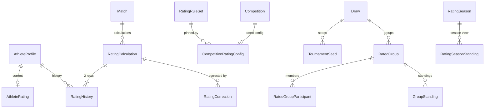

# RATING_ARCHITECTURE — рейтинговая система и рейтинговые турниры

Статус: **проект, до утверждения заказчиком** (анализ 2026-10-18, версия платформы 0.13.1). Кода ещё нет.
Правила расчёта — [RATING_RULES.md](RATING_RULES.md); формат турнира — [RATED_TOURNAMENT_FORMAT.md](RATED_TOURNAMENT_FORMAT.md).

## 1. Где рейтинг встаёт в текущую архитектуру

Платформа — модульный монолит NestJS (`apps/api/src/modules/<domain>`: `api → application → domain`), Prisma + PostgreSQL 16, фоновые задачи в `apps/worker` (BullMQ), события — transactional outbox (`OutboxService.enqueue` в транзакции команды, ADR-08), аудит — `AuditService.record` в той же транзакции, права — каталог `packages/contracts/src/permissions.ts` и матрица `roles.ts`, схемы API — Zod в `packages/contracts`.

Что уже есть и на что опирается рейтинг:

| Есть | Где | Как используется |
|---|---|---|
| `Competition` (статусы DRAFT → … → ARCHIVED, `publishedAt`) | `schema.prisma` | Добавляется `competitionType`; «защищённое состояние» — опубликован или есть рейтинговый расчёт |
| `CompetitionCategory.formatOverride`, `Draw.format` (`CompetitionFormatCode`) | — | Новый формат `SPECIAL_GROUP_RATED` |
| `AthleteProfile` (+ `Person`) | — | Новая `AthleteRating` 1:1 по `athleteId` |
| `Entry` → `MatchParticipant` (сторона RED/BLUE) | — | Спортсмены схватки: `entry.athleteId` |
| `MatchResult` (`PROVISIONAL → CONFIRMED → PUBLISHED / AMENDED`, `method`, `methodDetail`, `redScore`, `blueScore`, `revision`) | `refereeing/results.service.ts` | Рейтинг считается после `CONFIRMED`; `AMENDED` — корректировка |
| Событие `match.result_confirmed` (outbox, в транзакции подтверждения) | `packages/contracts/src/events.ts` | Триггер расчёта |
| Событие `match.result_amended` (`winnerChanged`) | `refereeing/amend.service.ts` | Триггер корректировки |
| `Bracket.kind = POOL / FINAL`, `SlotSource.POOL_RANK`, `placeForWinner/Loser` | `brackets/domain` | Группы и финал рейтингового формата |
| Стратегии форматов (`brackets/domain/strategies.ts`, «точка расширения») | — | Новая стратегия `SPECIAL_GROUP_RATED` |
| Воспроизводимая жеребьёвка (PRNG, `Draw.input`, `seedNumber`) | `draws/domain` | Посев по рейтингу + `TournamentSeed` |
| `Entry.activeMatchId` (спортсмен не может быть в двух идущих схватках) | Phase 7a | Схватки одного спортсмена идут последовательно |
| Права PLATFORM-скоупа только у `SUPER_ADMIN`/`PLATFORM_ADMIN` в роли кабинета «Администратор» (TOTP) | `cabinet-roles.ts` | Все рейтинговые права — PLATFORM |
| В планах Phase 9 — `RankingSystem` (очки за места), право `ranking.manage` (у FEDERATION_ADMIN) | DATABASE.md 3.7 | **Отдельная вещь.** Elo не заменяет очковые рейтинги федераций; имена таблиц `rating_*` не пересекаются с `ranking_*` |

## 2. Контексты и зависимости

```
competitions ──(competitionType, CompetitionRatingConfig)──┐
draws ──(TournamentSeed: посев + ratingAtDraw)──────────────┤
brackets ──(стратегия SPECIAL_GROUP_RATED, GroupStanding)───┤
refereeing ──(match.result_confirmed / result_amended)──────┼──► rating
                                                            │     ├─ domain/   формула, K, S, уровень, округление (чистые функции, decimal.js)
                                                            │     ├─ application/ RatingCalculationService, RebuildService,
                                                            │     │                LeaderboardQueries, CorrectionService
                                                            │     └─ api/      /rankings, /athletes/:id/rating-history, /admin/…
public, notifications, live ◄── rating.calculated, rating.athlete_updated
```

- Новый модуль `apps/api/src/modules/rating`; `domain/` — без NestJS и Prisma (правило dependency-cruiser).
- Рейтинг **не пишет** в `MatchResult` и `Match`; результат схватки не знает о рейтинге (ТЗ 53). Связь — только `matchId` в `RatingCalculation`.
- Формат `SPECIAL_GROUP_RATED` не зависит от модуля `rating`: посев получает рейтинг через порт `RatingSnapshotPort` (интерфейс в `draws`, реализация в `rating`).

## 3. Тип турнира и права

### 3.1 `competitionType`

- `Competition.competitionType` — `NON_RATED` (по умолчанию) | `RATED`; `NOT NULL DEFAULT 'NON_RATED'`.
- `POST /api/v1/competitions`: поле есть в схеме. Если `RATED` и у пользователя нет `competition.create_rated` (PLATFORM) — **403 `RATED_COMPETITION_FORBIDDEN`** (явный отказ, не тихое удаление поля; Zod по умолчанию лишние поля отбрасывает — здесь поле объявлено, чтобы проверка была явной). `PATCH /competitions/:id` поле не принимает вовсе.
- Включение рейтинга у существующего турнира — только `POST /api/v1/admin/competitions/:id/rating` (`competition.convert_to_rated`), с причиной; создаёт `CompetitionRatingConfig` и запись аудита с `platformIntervention = true`.
- **Защищённое состояние**: `publishedAt IS NOT NULL` **или** существует `RatingCalculation` турнира. После него тип не меняется ни в одну сторону. Защита — триггер БД `forbid_competition_type_change`: разрешает изменение только при `current_setting('sde.rating_type_change', true) = 'on'`, которое ставит административная процедура `POST /admin/competitions/:id/rating-type-change` (`competition.convert_to_rated`, причина обязательна, аудит, только если нет ни одного рейтингового расчёта; иначе — отказ и путь через корректировки).
- Организатор видит тип турнира, но не может его изменить; кнопки «Сделать рейтинговым» у него нет (UI повторяет серверную проверку, не заменяет её).

### 3.2 Новые права (PLATFORM)

| Право | SUPER_ADMIN | PLATFORM_ADMIN | Остальные |
|---|---|---|---|
| `competition.create_rated` | ● | ● | — |
| `competition.convert_to_rated` | ● | ● | — |
| `competition.manage_rating_rules` | ● | — | — |
| `competition.recalculate_rating` | ● | ● | — |
| `competition.view_rating_audit` | ● | ● | — |
| `competition.publish_rating_results` | ● | ● | — |
| `rating.correct` (RatingCorrection, freeze) | ● | ● | — |
| `rating.rebuild_apply` (применить итог rebuild к production) | ● | — | — |

`PLATFORM_ADMIN` сейчас не имеет `competition.create` (скоуп ORGANIZATION), поэтому рейтинговый турнир создаётся так: организатор (или SUPER_ADMIN от организации) создаёт турнир, платформа включает рейтинг процедурой 3.1 — либо SUPER_ADMIN создаёт сразу `RATED`. Права на операции турнира (`draw.*`, `result.*`) у организатора остаются; рейтинговых прав у ролей турнира и организации нет (ТЗ 65). После изменения каталога — миграция данных `--access-only` (CONTRIBUTING.md).

## 4. Версии правил (`RatingRuleSet`)

- Одна строка — одна неизменяемая версия: `initialRating`, `kFactorRules`, `scoreRules`, `levelRules`, `roundingRule`, `engineVersion`, `activeFrom`, `activeTo`, `status` (`DRAFT → ACTIVE → RETIRED`). После `ACTIVE` строка не меняется (триггер, как `forbid_update_published_rule_set_version`).
- Турнир закрепляет версию при включении рейтинга (`CompetitionRatingConfig.ruleSetId`) — как `Competition.ruleSetVersionId` закрепляет правила соревнований (ADR-09). Матч 2026 года считается по правилам 2026 года, даже если его пересчитывают в 2028.
- `calculationVersion` расчёта = `"{ruleSet.code}@{ruleSet.version}/{engineVersion}"`.
- Начальная версия `sambo-elo@1`: initial 200; K 60/30/10 (≤100 / ≤300 / >300); S — таблица RATING_RULES.md, 3; уровни по 200 от 200; `INTEGER_HALF_UP`. Классификатор исходов — по правилам № 892 (RATING_RULES.md, 3.1).

Политики домена (чистые функции, тесты без БД): `RatingKFactorPolicy.kFor(rating)`, `RatingScorePolicy.scoreFor(outcome)`, `MatchOutcomeClassifier.classify(result)` (WinMethod + счёт → один из 8 исходов; правило — часть версии, RATING_RULES.md, 3.1), `RatingLevelPolicy.levelOf(rating)`, `roundRating(decimal)`, `EloFormula.expected(ra, rb)`. Фронтенд уровень не вычисляет — получает `level` с сервера.

## 5. Модель данных

Полное описание с ограничениями — DATABASE.md, раздел 3.10 (проект). Кратко:



| Сущность | Назначение | Изменяемость |
|---|---|---|
| `AthleteRating` | Текущее состояние (read model + строка для блокировки): rating, peak, lowest, matches, wins, losses, status ACTIVE/FROZEN/SUSPENDED, version | Только через расчёт и корректировки |
| `RatingHistory` | Строка на спортсмена на расчёт: before/after/delta, levels, соперник и его рейтинг до, S, E, K, точное значение до округления, версия | **Append-only** (у `sde_app` нет UPDATE/DELETE) |
| `RatingCalculation` | Факт расчёта схватки: `UNIQUE (matchId, calculationVersion)`, статус, снимок входа | Статус меняется только вперёд |
| `RatingRuleSet`, `RatingLevel` | Версии правил; уровни — строки версии (для фильтров и подписей) | Неизменяемы после ACTIVE |
| `CompetitionRatingConfig` | Рейтинговые настройки турнира: версия правил, кто и когда включил, публичность дельт | Меняется до защищённого состояния |
| `TournamentSeed` | Посев жеребьёвки: athleteId, entryId, seedNumber, ratingAtDraw | Неизменяем после публикации жеребьёвки; изменение — новая версия `Draw` |
| `RatedGroup`, `RatedGroupParticipant` | Подгруппа жеребьёвки и её состав (позиция в подгруппе) | Как `Draw` |
| `GroupStanding` | Таблица подгруппы: место, победы, поражения, очки, тай-брейки, qualified | Пересчитывается при подтверждении схватки |
| `RatingCorrection` | Корректировка без удаления истории | Append-only |
| `RatingSeason` | Сезон (2026, 2027) — представление поверх истории, Elo не сбрасывается | — |

## 6. Расчёт после схватки

### 6.1 Поток

```
MatchResult CONFIRMED  (транзакция подтверждения, как сейчас)
  └─ outbox: match.result_confirmed
        └─ потребитель rating (worker, BullMQ; ProcessedEvent — дедупликация)
              ├─ турнир NON_RATED → ничего (ни строки)
              ├─ схватка не рейтинговая (BYE, проиграли оба) → RatingCalculation SKIPPED (для аудита)
              └─ RATED → calculateRating(matchId) в отдельной транзакции
                    └─ outbox: rating.calculated → rating.athlete_updated → live / notifications / leaderboard
```

Почему не в транзакции подтверждения: ошибка рейтинга не должна откатывать подтверждение судьи и останавливать ковёр; рейтинг — побочный эффект, который не теряется (outbox, ADR-08). Задержка — секунды.

### 6.2 `calculateRating(matchId)` — одна транзакция

1. `SELECT … FROM rating_calculation WHERE match_id = $1 AND calculation_version = $v` — есть `COMPLETED` → вернуть его (идемпотентность, ТЗ 17).
2. Прочитать подтверждённый результат и участников; турнир `RATED`; версия правил — из `CompetitionRatingConfig`.
3. Создать недостающие `AthleteRating` (`INSERT … ON CONFLICT DO NOTHING`, initial из версии).
4. `SELECT … FOR UPDATE` строк `AthleteRating` обоих спортсменов **в порядке `athlete_id`** — без взаимных блокировок при параллельных коврах (ТЗ 70).
5. Проверка порядка: нет ли у любого из двоих более ранней (по `match.finished_at`) рейтинговой схватки без завершённого расчёта → если есть, `PENDING` и повтор после неё (подтверждения на разных коврах могут прийти не по порядку).
6. Статус спортсмена `FROZEN`/`SUSPENDED` → `PENDING` с причиной (политика — решение заказчика, ТЗ 67).
7. Расчёт в decimal: E_A, E_B, K_A, K_B, S по классификатору, точные R', `roundRating`, уровни.
8. `INSERT rating_calculation` (`UNIQUE (match_id, calculation_version)` — второй параллельный обработчик получит конфликт и выйдет).
9. `INSERT rating_history` × 2.
10. `UPDATE athlete_rating` × 2 (`version = version + 1`, peak, lowest, счётчики).
11. `AuditService.record('rating.calculated', …)` — входы, K, E, S, до/после, версия.
12. `OutboxService.enqueue('rating.calculated')`.

Любая ошибка — ROLLBACK, событие повторяется (`attempts`, `lastError`); после N попыток — `RatingCalculation FAILED` + счётчик ошибок в админ-панели.

### 6.3 Снимок рейтинга до схватки

`RatingHistory.ratingBefore` и `opponentRatingBefore` — снимок на момент расчёта, и расчёт выполняется строго по порядку схваток спортсмена (п. 5), поэтому «до схватки» = «после предыдущей рейтинговой схватки». Исторические схватки всегда показывают эти значения (ТЗ 19).

### 6.4 Изменение подтверждённого результата (`match.result_amended`)

Историю не удаляем и не переписываем. Предложение (Q-A1):

- Исход схватки изменился → новый расчёт **той же схватки** с теми же `ratingBefore` (из истории), разница к уже начисленному оформляется `RatingCorrection` по каждому спортсмену + `AuditLog`; `RatingCalculation` прежнего варианта — `SUPERSEDED`.
- Последующие схватки **не пересчитываются автоматически** (их `ratingBefore` уже зафиксированы); расхождение видно в отчёте `rebuild` и исправляется администратором.

### 6.5 `rebuildAthleteRating(athleteId)`

Только чтение по умолчанию: начальный рейтинг версии → все `COMPLETED` расчёты и корректировки спортсмена по времени → итог, сравнение с `AthleteRating.rating` → discrepancy report (по каждой схватке: записано / пересчитано / разница). Применение к production — отдельная команда с `rating.rebuild_apply`, причиной и аудитом: создаёт `RatingCorrection`, а не правит историю. Матчи пересчитываются **по своей закреплённой версии правил**, не по текущей (ТЗ 23, 42).

### 6.6 Арифметика

decimal.js (34 значащих цифры) в `domain/`; в БД — `NUMERIC` для E, K, S и точного R'; рейтинг — `INTEGER`. Никаких `number` в расчёте; тест-свойство: одна и та же схватка, посчитанная дважды, даёт побитово одинаковый результат.

## 7. Рейтинговый формат турнира

Подробно — RATED_TOURNAMENT_FORMAT.md. Компоненты:

| Сервис | Слой | Что делает |
|---|---|---|
| `RatedTournamentFormatEngine` | `brackets/domain` | По N и версии правил формата выбирает правило (группы, выход, размер финала); `INSUFFICIENT_PARTICIPANTS` |
| `RatedGroupSeedingService` | `draws/domain` | Посев по `ratingAtDraw` (равенство — PRNG жеребьёвки), змейка по g подгруппам |
| `RatedGroupAssignmentService` | `draws/application` | Создаёт `TournamentSeed`, `RatedGroup`, `RatedGroupParticipant` в черновике жеребьёвки |
| Стратегия `SPECIAL_GROUP_RATED` | `brackets/domain/strategies.ts` | Граф: POOL-сетки по схемам кругов (данные версии) + FINAL с `POOL_RANK`-источниками |
| `GroupStandingsService` | `brackets/application` | Таблица подгруппы по `GroupStandingRules`; `qualified` |
| `FinalBracketService` | `brackets/application` | Заполняет узлы финала из мест подгрупп, когда подгруппа завершена |
| `PlacementRule` | `brackets/domain` | Места: финал 1/2, оба полуфиналиста 3 |

Рейтинг считается за каждую подтверждённую схватку рейтингового турнира — групповую, четвертьфинал, полуфинал, финал (ТЗ 30); формат о рейтинге не знает.

## 8. API

Префикс — `/api/v1` (как у всего API).

| Метод | Путь | Доступ | Ответ |
|---|---|---|---|
| GET | `/rankings` | Public | Позиция, спортсмен (имя — по согласию на распространение ПДн, иначе клуб/регион), Elo, уровень, peak, матчи, W/L, изменение позиции; фильтры `gender`, `ageFrom/To`, `weight`, `region`, `club`, `season`; курсорная пагинация |
| GET | `/rankings/{athleteId}` | Public | Позиция и карточка рейтинга |
| GET | `/athletes/{id}/rating-history` | Public (с тем же правилом имён) | `[{date, rating, delta, competition, match, opponent}]` — для графика X = дата, Y = Elo |
| GET | `/competitions/{id}/rating-summary` | Public, если `CompetitionRatingConfig.publicDeltas` | Участники: до / после / Δ за турнир |
| GET | `/competitions/{id}/rated-matches` | Public, то же | Схватки с `ratingBefore/After`, `delta`, `levelBefore/After` обоих |
| POST | `/admin/competitions/{id}/rating` | `competition.convert_to_rated` | Включить рейтинг, закрепить версию правил |
| POST | `/admin/competitions/{id}/recalculate-rating` | `competition.recalculate_rating` | Довыполнить `PENDING`/`FAILED` расчёты турнира (уже выполненные не трогает) |
| POST | `/admin/athletes/{id}/rebuild-rating` | `competition.recalculate_rating` (отчёт), `rating.rebuild_apply` (применить) | Discrepancy report / корректировка |
| POST | `/admin/athletes/{id}/rating-corrections` | `rating.correct` | Корректировка с причиной |
| PUT | `/admin/athletes/{id}/rating-status` | `rating.correct` | ACTIVE / FROZEN / SUSPENDED |
| GET · POST | `/admin/rating-rule-sets` | `competition.manage_rating_rules` | Версии правил |
| GET | `/admin/rating/dashboard` | `competition.view_rating_audit` | Рейтинговые турниры, активные, спортсмены, схватки, средний и максимальный Elo, ошибки расчёта |
| GET | `/admin/rating/calculations` | `competition.view_rating_audit` | Журнал расчётов с фильтрами |

Все новые маршруты проходят автотест `route-security.e2e.test.ts`. Фронтенд Elo не считает: получает `ratingBefore`, `ratingAfter`, `delta`, `levelBefore`, `levelAfter`.

## 9. Фронтенд

- Создание турнира: переключатель «Тип: Безрейтинговый / Рейтинговый» — «Рейтинговый» только при `competition.create_rated` в выбранной роли. После выбора — версия правил, начальный рейтинг, версия формулы, формат, правила групп и посева (только чтение для организатора).
- Карточка турнира организатора: метка «Безрейтинговый» / «Рейтинговый»; без кнопки «Сделать рейтинговым».
- Админ-панель «Рейтинг»: дашборд, версии правил, журнал расчётов, ошибки, корректировки, rebuild.
- Публичная страница `/rating`: место, спортсмен, Elo, уровень, изменение.
- Публичная страница турнира: метка «Рейтинговый турнир», подгруппы и таблицы, финальная сетка, `+XX / −XX Elo` у завершённых схваток (если включено).
- Профиль спортсмена: Elo, уровень, место, peak, матчи, win rate, график, последние схватки, рейтинговые турниры.
- Живые обновления: событие `rating.athlete_updated` через существующий WebSocket-шлюз (Phase 8a).

## 10. Производительность

- `AthleteRating` — и есть read model рейтинга: индекс `(status, rating DESC, athlete_id)`; позиция — `count(*) WHERE rating > x` по индексу или `rank()` по странице.
- Изменение позиции — ежедневный снимок `rating_rank_snapshot (date, athlete_id, rank)` (worker), а не пересчёт истории на запрос.
- Сезонный рейтинг — агрегат `RatingHistory` по сезону, материализуется worker-ом после расчётов.

## 11. Тесты

| Уровень | Что |
|---|---|
| Unit `rating/domain` | Формула: равные рейтинги, большая разница, низкий рейтинг; K = 60 / 30 / 10 и границы 100, 101, 300, 301; все 8 значений S; округление (x,5, отрицательные); уровни 199/200/399/400/…/2000/5000; контрольные примеры RATING_RULES.md, 7 (Excel — допуск 1e-9) |
| Unit `brackets/domain`, `draws/domain` | N = 1…39 и отказ для 40+: число групп, размеры, выход, размер финала, нет потерянных и дублей, переходы, BYE; змейка; схемы кругов = таблица G1; примеры 6, 12, 24, 39 |
| Property | Каждый спортсмен — ровно в одной подгруппе; в финале — только квалифицированные; ни в каких двух одновременно идущих схватках; сумма Δ при равных K = 0 |
| Integration (PostgreSQL) | NON_RATED не создаёт строк; RATED — 1 расчёт, 2 истории; повтор события — без второго начисления; два параллельных подтверждения одного спортсмена — порядок по `finished_at`; параллельные ковры с разными спортсменами — без блокировок; откат при ошибке; организатор → 403 на RATED и на `/admin/*`; триггер типа турнира; append-only истории |
| E2E | Рейтинговый турнир: создание платформой → заявки → жеребьёвка по рейтингу → группы → финал → Elo после каждой схватки → итоги → leaderboard |

## 12. План миграции БД

Миграции пишутся вручную (`prisma migrate diff` + SQL-шаги), каждая — отдельный PR фазы, без изменения существующих данных:

| # | Миграция | Содержимое | Фаза |
|---|---|---|---|
| M1 | `…_rating_rule_set` | `rating_rule_set`, `rating_level`; триггер неизменяемости ACTIVE; seed `sambo-elo@1` в `DRAFT` | 1–2 |
| M2 | `…_athlete_rating` | `athlete_rating` (PK = athlete_id), enum `rating_status`, CHECK, индекс рейтинга | 3 |
| M3 | `…_rating_history_calculation` | `rating_calculation` (UNIQUE match+version), `rating_history`, `rating_correction`; `REVOKE UPDATE, DELETE ON rating_history, rating_correction FROM sde_app` | 4–5 |
| M4 | `…_competition_type` | enum `competition_type`, `competition.competition_type NOT NULL DEFAULT 'NON_RATED'` (существующие турниры — NON_RATED без пересчёта), `competition_rating_config`, триггер `forbid_competition_type_change` | 8 (поле — раньше, в 6, для проверки в потребителе) |
| M5 | `…_access_rating` | Права раздела 3.2 (`generate-data-migration --access-only`) | 8 |
| M6 | `…_rated_format` | Значение `SPECIAL_GROUP_RATED` в `competition_format_code`, `tournament_seed`, `rated_group`, `rated_group_participant`, `group_standing` | 9–11 |
| M7 | `…_rating_season_snapshot` | `rating_season`, `rating_rank_snapshot` | 7 / 15 |

Откат: каждая миграция — только добавление таблиц и колонок с умолчанием; откат приложения не требует отката схемы. Backfill не нужен: `AthleteRating` создаётся лениво при первой рейтинговой схватке (или пакетно для лидерборда «все с 200»; решение — Q-A3).

## 13. Фазы реализации (ТЗ 75) и что их блокирует

| Фаза | Содержание | Блокирует |
|---|---|---|
| 1 | Домен рейтинга: формула, политики, округление, unit-тесты | — (формула общая для обоих файлов) |
| 2 | `RatingRuleSet` + версия `sambo-elo@1` в DRAFT | Q-R1 — до активации |
| 3 | `AthleteRating` | — |
| 4 | `RatingHistory` | — |
| 5 | `RatingCalculation`, идемпотентность, транзакция | — (Q-R1–Q-R3 решены 2026-10-18) |
| 6 | Интеграция с подтверждением результата, порядок, корректировки | Q-A1 |
| 7 | Leaderboard | Q-A2 (публичность имён детей) |
| 8 | `competitionType`, права, админ-процедура | — |
| 9 | Формат `SPECIAL_GROUP_RATED` (правила 3–39; 40+ не делаем) | Q-F1 |
| 10 | Генерация групп, посев, змейка | — |
| 11 | Таблицы подгрупп, выход | Q-F4 |
| 12 | Финальная сетка, места | Q-F5 (места 5+) |
| 13 | Живые обновления рейтинга | — |
| 14 | Корректировки, freeze, rebuild | Q-A4 (поведение FROZEN) |
| 15 | Профиль спортсмена, сезоны | — |
| 16 | E2E рейтингового турнира | Все выше |

Блокирующих вопросов не осталось: все фазы можно начинать после утверждения архитектуры.

## 14. Риски

| Риск | Почему важно | Мера |
|---|---|---|
| Уровни 1–10 почти недостижимы | При K = 10 выше 300 за чистую победу над равным +5; от 300 до 2000 — сотни побед подряд. Шкала уровней ТЗ (до 2000) и K Приложения 5 из разных моделей | Подтвердить шкалу (Q-A5); уровни — данные версии |
| Отрицательный рейтинг | При K = 60 и рейтинге < 30 поражение уводит ниже 0 | Q-R4: пол рейтинга (0?) как параметр версии |
| Толкование «небольшого» и «минимального» преимущества | В правилах № 892 таких видов победы нет; разбиение по пунктам ст. 34 подтверждено заказчиком, но может меняться | Классификатор — данные версии правил; правка — новая версия |
| Публичность рейтинга детей | Имена несовершеннолетних публикуются только по согласию (ФЗ-152, Phase 3); рейтинг + место + клуб идентифицируют ребёнка | В публичном лидерборде — правило показа имён как у табло; Q-A2 |
| Порядок подтверждений на разных коврах | Неверный `ratingBefore`, если расчёты идут не по порядку | Шаг 5 раздела 6.2 + тест |
| Изменение результата после расчёта | История не переписывается, цепочка последующих расчётов «съезжает» | Корректировки + rebuild-отчёт; Q-A1 |
| 40+ участников | Не поддерживаются (решение заказчика) | Отказ `TOO_MANY_PARTICIPANTS` при жеребьёвке рейтингового формата |
| Взаимоисключающие редакции схемы | G1 и Приложение 1 расходятся для 24+ | Q-F1 |

## 15. Открытые вопросы (сводка)

Решены 2026-10-18: Q-R1 (Приложение 5), Q-R2 (по правилам № 892, RATING_RULES.md, 3.1; толкование ст. 34 подтверждено), Q-R3 (неявка, снятие, травма, дисквалификация = чистая победа соперника), Q-F2 (40+ не делаем).

Неблокирующие, с предложенным умолчанием: Q-F1 (24+: по 1 из подгруппы), Q-F3 (подгруппа из 3 — полный круг), Q-F4 (места в подгруппе), Q-F5 (места 5+), Q-F6 (красный угол), Q-F7 (разведение клубов — нет), Q-R4 (пол рейтинга), Q-A1 (изменение результата → корректировка), Q-A2 (публичные имена — по согласию), Q-A3 (лениво создавать `AthleteRating`), Q-A4 (FROZEN — расчёт в ожидании), Q-A5 (шкала уровней при K = 10), Q-A6 (кто может создавать рейтинговые турниры: только платформа или и федерация).
